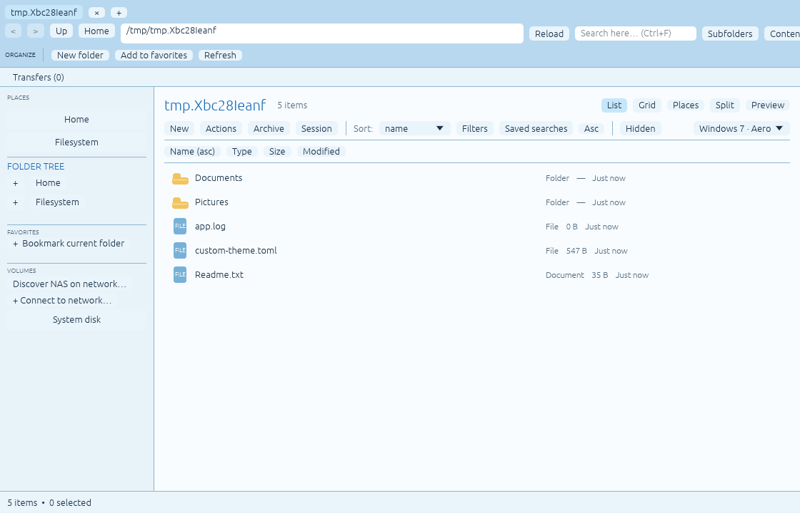
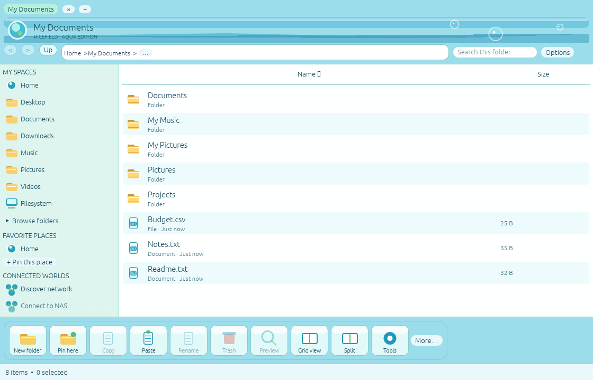
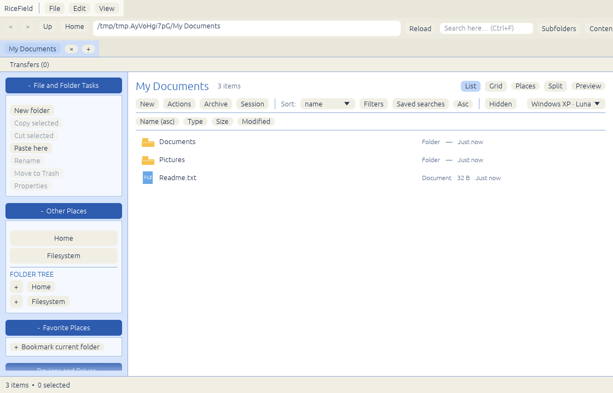
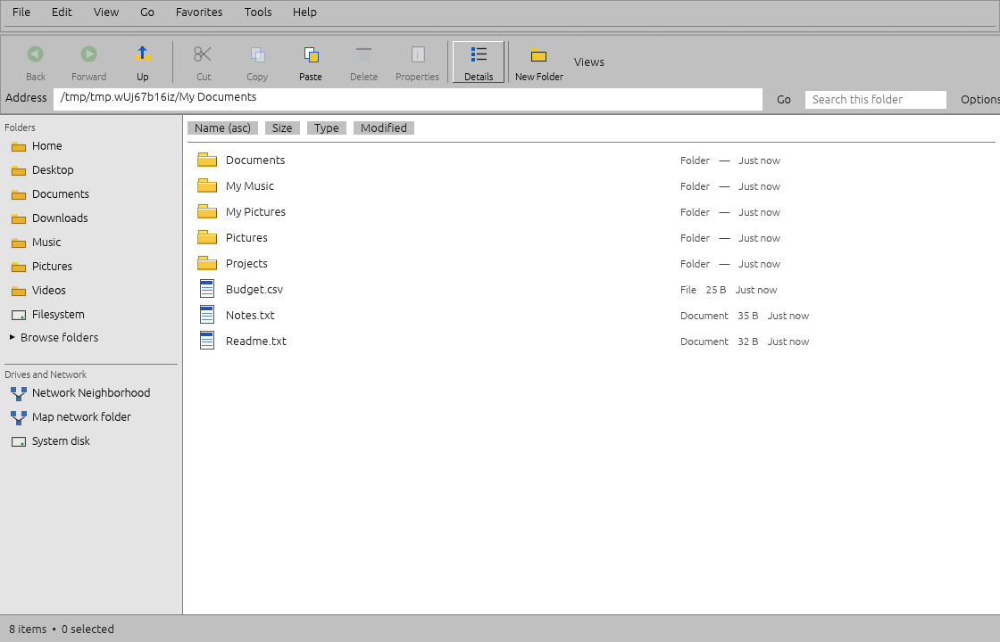
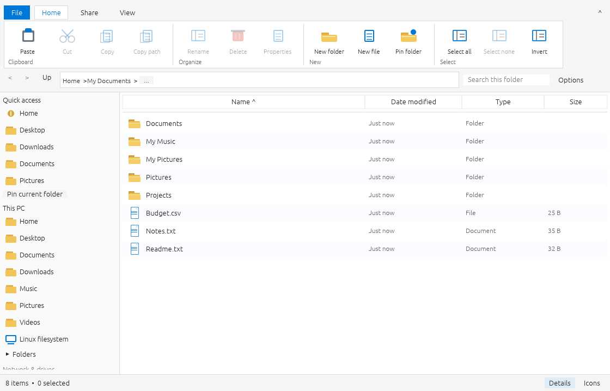
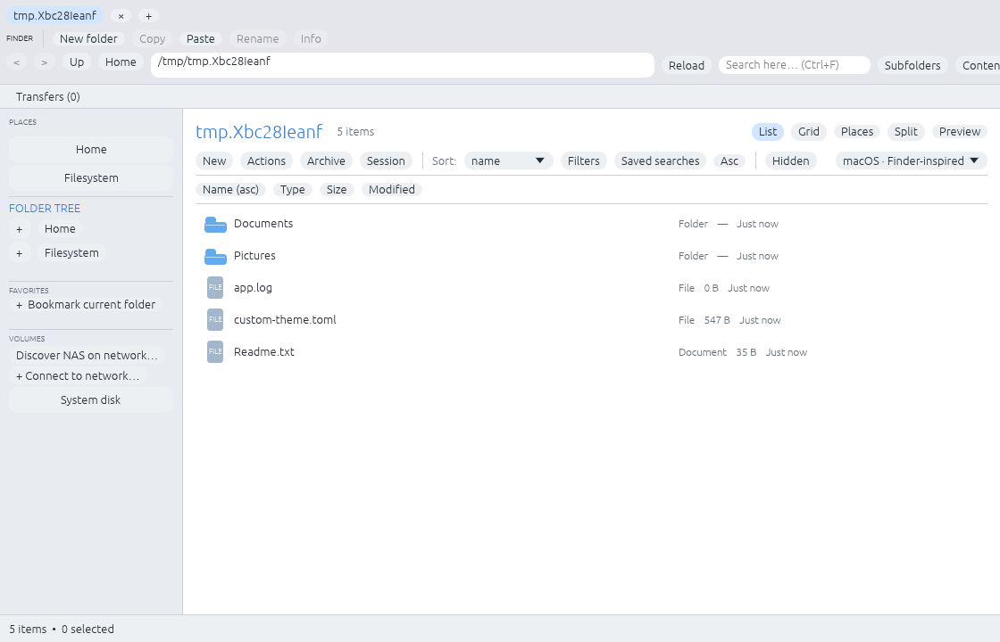
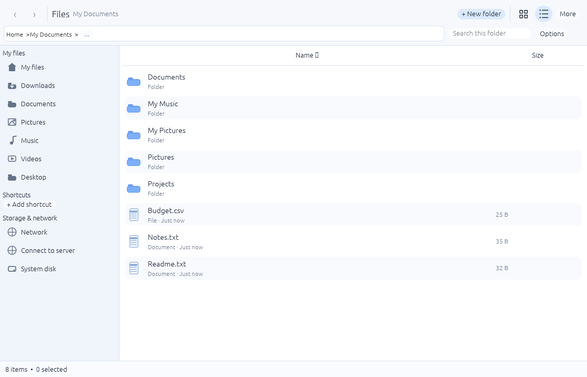

<div align="center">


# RiceField

**A file manager with seven personalities — and one reliable Rust engine.**

A standalone Linux file manager built with **Rust + egui**. Familiar file management, deliberate data-safety rules and seven genuinely different desktop interfaces. Use it on its own or alongside [RiceBowl](https://github.com/CopyPasteUser/Ricebowl).

[Explore the interfaces](#seven-desktops-one-engine) · [Get started](#get-started) · [Make it your default](#make-ricefield-your-default) · [Documentation](#documentation)

[](https://github.com/CopyPasteUser/Ricefield/actions/workflows/ci.yml)
[](https://github.com/CopyPasteUser/Ricefield/actions/workflows/smb-safety.yml)

**Linux x86_64** · **X11 / Wayland-capable UI** · **MIT licensed**

</div>

---

## Seven desktops. One engine.

RiceField does not just recolor the same toolbar. Each *rice* has its own navigation, layout, controls and visual language; all seven use the same underlying file operations. Window borders and titlebars are provided by your Linux window manager.

| Windows 7 · Aero | Frutiger Aero · Blue Skies |
| :---: | :---: |
| [](docs/screenshots/win7.png) | [](docs/screenshots/frutiger-aero.png) |

<details>
<summary><strong>Explore the other five interfaces</strong> — XP Luna, Windows 98, Windows 10, macOS and ChromeOS</summary>

<br>

| Windows XP · Luna | Windows 98 · Classic Explorer | Windows 10 · Ribbon |
| :---: | :---: | :---: |
| [](docs/screenshots/xp-luna.png) | [](docs/screenshots/win98.png) | [](docs/screenshots/win10.png) |

| macOS · Finder-inspired | ChromeOS · Files-inspired |
| :---: | :---: |
| [](docs/screenshots/macos.png) | [](docs/screenshots/chromeos.png) |

</details>

**[Open the full screenshot gallery →](docs/screenshots/README.md)** — real screenshots of the running application, including split views, compact layouts, menus and dialogs. No screenshot files are modified by this README.

## Built for everyday file work

| Area | What RiceField provides |
| --- | --- |
| **Navigate** | Tabs, separate windows, two-pane split view, breadcrumbs, history, favorites and Places |
| **Organize** | Copy, move, rename, trash, duplicate, symbolic links, clipboard operations, multi-selection and drag selection |
| **Work faster** | Search and filtering, previews and thumbnails, file properties, `Open With`, folder-background context actions and a terminal launcher |
| **Keep control** | Per-transfer conflict choices, non-overwriting operations, transfer queue/history, eligible session Undo and recovery inspection |
| **Open archives** | Browse and extract ZIP, TAR, 7z and RAR archives using libarchive |
| **Connect storage** | SMB, SFTP, WebDAV and MTP browsing; mounted local/network volumes and UDisks2/Polkit device actions |
| **Customize** | Seven built-in rice profiles, editable TOML themes and optional live RiceBowl theme integration |

### A few everyday workflows

- **Right-click empty folder space** to create a folder or file, paste, open the location in another tab/window, launch a terminal there or inspect the folder's properties.
- **Press `F3`** for split view. Each pane has its own location; file actions target the focused pane.
- **Press `Ctrl+N`** to create a folder, **`Ctrl+T`** for another tab, **`Ctrl+H`** to show hidden files.
- **Use `Ctrl+Shift+D`** to start an external drag via an installed `ripdrag` or `dragon` helper.

The [user guide](docs/USAGE.md) covers shortcuts, search behavior, transfers, mounted devices, network locations and recovery in detail.

## Get started

**Target:** Linux x86_64, with Ubuntu 24.04 / Linux Mint 22.x as the primary documented environment. Building from source requires a current [Rust toolchain](https://rustup.rs/) (`cargo` and `rustc`).

Install the Linux build dependencies:

```bash
sudo apt update
sudo apt install build-essential pkg-config libxcb-render0-dev \
  libxcb-shape0-dev libxcb-xfixes0-dev libxkbcommon-dev libxkbcommon-x11-0 \
  libssl-dev libgl1-mesa-dev libarchive13t64 xdg-utils curl
```

Clone, build, install for **your user**, and launch:

```bash
git clone https://github.com/CopyPasteUser/Ricefield.git
cd Ricefield
bash install.sh
ricefield
```

`install.sh` builds a release binary and installs the user-local application launcher. It **does not** change your default file manager, replace Thunar or enable the experimental file picker. For packaged builds and checksums, see [GitHub Releases](https://github.com/CopyPasteUser/Ricefield/releases) and the [release guide](RELEASE.md).

### Pick a desktop

```bash
ricefield --theme xp-luna ~/Documents
ricefield --theme win7 ~/Downloads
ricefield --theme frutiger-aero ~/Pictures
ricefield --theme macos
```

Available IDs: `win98`, `xp-luna`, `win7`, `win10`, `frutiger-aero`, `chromeos`, `macos`.

RiceField also supports custom TOML files:

```bash
ricefield --check-theme-file /path/to/my-rice.toml
ricefield --theme-file /path/to/my-rice.toml
```

See the [theme and session guide](docs/USAGE.md) for live RiceBowl profiles and customization.

## Make RiceField your default

Switching your preferred folder handler is **opt-in**. It is separate from simply installing RiceField and does not uninstall or stop your existing file manager.

| Action | Command |
| --- | --- |
| Set as **your** default file manager | `bash install.sh --default-file-manager` |
| Inspect the current managed registration | `bash install.sh --default-file-manager-status` |
| Restore the previous user default | `bash install.sh --restore-default-file-manager` |

After activation, verify the directory handler:

```bash
xdg-mime query default inode/directory
```

The integration covers XDG directory links, Xfce's file-manager helper and new FileManager1 activations. It **does not** replace desktop icons, another user's settings, already-running instances or arbitrary GTK application file dialogs. Restoration preserves backups and refuses to overwrite later edits made by other applications.

**[Read the complete default-manager guide](docs/DEFAULT_FILE_MANAGER.md)** for user/system scope, verification and rollback.

### FileChooser integration: experimental

RiceField also has an **optional XDG FileChooser portal backend** for open/save requests from portal-aware applications. It is **not enabled by the normal installer**, does not replace every GTK file dialog and requires separate system/user registration. Treat it as an advanced opt-in integration and test your desktop before using it for important workflows.

**[Setup, compatibility and rollback instructions](docs/DEFAULT_FILE_PICKER.md)**

## Safety by design

RiceField intentionally distinguishes what a local filesystem can do from what an arbitrary network server can safely guarantee.

| Location / feature | Supported behavior and boundary |
| --- | --- |
| **Local files and mounted volumes** | Normal file operations with guarded conflicts; behavior still depends on filesystem capabilities and permissions |
| **SMB, SFTP and WebDAV** | Browse, preview and download; **guarded single-file uploads** only on supported, validated server configurations |
| **MTP and unsupported remote writes** | Browse where supported; mutating operations are disabled |
| **Remote rename/delete/folder creation** | Not supported by the direct remote backends; no implicit overwrite-prone fallback |
| **Undo** | Available for eligible session operations only; it is **not** a universal reversal of copies, deletes or cross-volume moves |
| **Interrupted operations** | Show recovery evidence for review; no automatic destructive recovery |
| **External drag-and-drop** | Outgoing drag uses optional `ripdrag`/`dragon` helpers; XWayland incoming drag has a separate opt-in path |

The current code is designed to fail closed when remote capabilities or recovery state cannot be trusted. **Keep backups and a second file manager for irreplaceable data.**

Read the [remote capability matrix](docs/REMOTE-1.0-SCOPE.md), [recovery runbook](docs/REMOTE-RECOVERY-RUNBOOK.md) and [support/verification status](docs/1.0-STATUS.md) before relying on less-common workflows.

## Project status

| Track | Status |
| --- | --- |
| **Stable release** | `1.0.0` — first stable release for the documented daily-use scope |
| **Development branch** | `main` — continued fixes and 1.1 preparation; changes here are **not automatically a 1.1 release** |
| **Desktop integrations** | Default file-manager switching is opt-in and reversible; FileChooser portal integration is experimental |
| **Quality gates** | Rust formatting, Clippy, unit/protocol tests, GUI smoke, packaging and rollback checks in CI |

The project's owner has reported everyday use with a NAS (including SMB uploads), SD cards and USB drives. That does **not** imply every ACL, concurrent-write, power-loss, disconnect, Wayland or accessibility edge case has been independently validated.

See [release policy](RELEASE.md), [roadmap](ROADMAP.md) and [changelog](CHANGELOG.md).

## Develop and contribute

```bash
cargo fmt --all -- --check
cargo clippy --locked --all-targets -- -D warnings
cargo test --locked --all-targets
cargo build --locked --release
```

The CI also exercises real disposable SMB fixtures, Xvfb GUI smoke tests, installer rollback and a 100,000-entry benchmark. These are reproducible software checks, **not** a substitute for real-device qualification.

Contributions should preserve existing file-operation semantics and document any new mutation, permission or recovery behavior. Start with [CONTRIBUTING.md](CONTRIBUTING.md).

## Documentation

| I want to… | Go to |
| --- | --- |
| Learn the interface, shortcuts and everyday operations | [User guide](docs/USAGE.md) |
| See every rice, split view and compact layout | [Screenshot gallery](docs/screenshots/README.md) |
| Configure Linux/Xfce/RiceBowl default handling | [Default file manager](docs/DEFAULT_FILE_MANAGER.md) |
| Configure or restore Open/Save portal dialogs | [FileChooser integration](docs/DEFAULT_FILE_PICKER.md) |
| Understand network writes and recovery limits | [Remote write scope](docs/REMOTE-1.0-SCOPE.md) · [Recovery runbook](docs/REMOTE-RECOVERY-RUNBOOK.md) |
| Investigate a problem or measure performance | [Troubleshooting](docs/TROUBLESHOOTING.md) · [Host memory profiling](docs/PERFORMANCE_HOST.md) |
| Review qualification, releases and future work | [1.0 status](docs/1.0-STATUS.md) · [Owner acceptance](docs/OWNER-ACCEPTANCE-1.0.md) · [Roadmap](ROADMAP.md) · [Changelog](CHANGELOG.md) |

---

<div align="center">

**Built for Linux · Written in Rust · Licensed under [MIT](LICENSE)**

RiceField is independent of Microsoft, Apple and Google. The interface styles are inspired by familiar desktop eras; bundled graphics are original and OS window decorations remain native.

</div>
