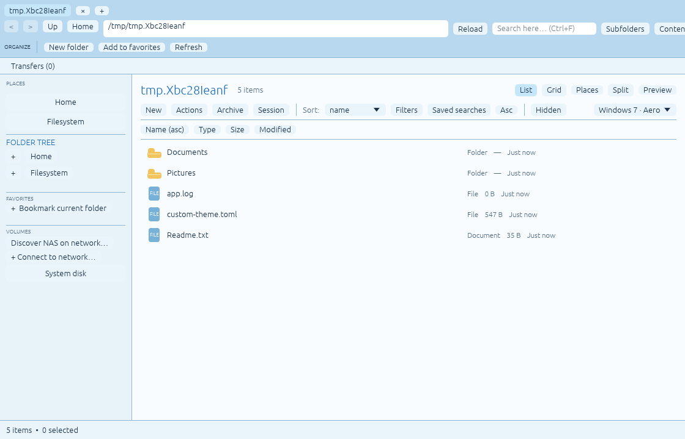

<div align="center">

# RiceField

**One file manager. Seven ways to make it yours.**

A customizable Linux file manager built with **Rust + egui**, designed to work on its own and eventually integrate with the [RiceBowl desktop](https://github.com/CopyPasteUser/Ricebowl).

[Get started](#install) · [User guide](docs/USAGE.md) · [1.0 acceptance status](docs/1.0-STATUS.md) · [Screenshots](docs/screenshots/)

[](https://github.com/CopyPasteUser/Ricefield/actions/workflows/ci.yml)

</div>



> **Status: 1.0.0-rc.10 candidate.** Not a signed-off stable 1.0. Physical Linux Mint, NAS and recovery acceptance is still open. Keep your current file manager and use disposable data for testing risky operations.

## Built for real file management

- **Explore:** tabs, split panes, folder tree, bookmarks, grid/list views and session restore.
- **Organize:** create, copy, move, rename (including cycle-safe batch rename), trash and link files, with progress, conflict previews and read-only transfer history across restarts.
- **Find:** filename and content search, glob/regex filters, saved searches, thumbnails and Quick Look.
- **Open archives:** create, browse and extract supported ZIP, TAR and 7z archives.
- **Reach your NAS:** discover and browse SMB, SFTP, WebDAV and MTP, queue bounded file/folder downloads to a chosen local location, and optionally save credentials in Secret Service.
- **Attach USB storage:** discover unmounted removable filesystems and request mounting through UDisks2/Polkit; existing system mounts remain browsable.
- **Rice it:** seven distinctive shells (98, XP, 7, 10, Frutiger Aero, ChromeOS and macOS) plus editable layout, colors and density.

File operations remain independent of the selected visual shell.

## Install

Target: **Linux x86_64** (release builds use Ubuntu 24.04 for Linux Mint 22 compatibility). The CLI and installed binary remain named `rice-explorer` for compatibility while the project branding becomes RiceField.

```bash
sudo apt install build-essential pkg-config libxcb-render0-dev \
  libxcb-shape0-dev libxcb-xfixes0-dev libxkbcommon-dev libxkbcommon-x11-0 \
  libssl-dev libgl1-mesa-dev libarchive13t64 xdg-utils

git clone https://github.com/CopyPasteUser/Ricefield.git
cd Ricefield
bash install.sh
rice-explorer
```

Building from source requires a current stable [Rust toolchain](https://rustup.rs/). Installation is user-local and does **not** replace your default file manager.

Prefer a bundle? Check [Releases](https://github.com/CopyPasteUser/Ricefield/releases) and verify its SHA-256 checksum before installing. See [release instructions](RELEASE.md).

### Try different shells

```bash
rice-explorer --theme win7 ~/Downloads
rice-explorer --theme xp-luna ~/Documents
rice-explorer --theme macos
rice-explorer --theme-file /path/to/my-rice.toml
```

## Important limits

- Cross-filesystem **Move** leaves the source intact after a verified copy; cleanup is a separate user decision.
- Batch rename uses atomic Linux name exchanges for selected-name cycles and attempts guarded rollback on ordinary errors. Completed batches offer session-only, identity-checked Undo; crash recovery and Undo after restart are unavailable. A crash or concurrent external modification can leave *partial names* requiring manual review; unrelated targets are never intentionally overwritten.
- Network tabs provide **read-only browsing and explicit downloads** to a configurable local folder (default `~/Downloads`, 8 GiB per download, no overwrite). Recursive downloads are limited to 4,096 entries, 512 folders, 16 levels and 20 minutes; GIO-reported symlinks/special entries cannot be downloaded. Remote uploads, rename and deletion remain disabled due to [an atomicity blocker](docs/REMOTE-WRITE-SAFETY.md).
- Recovery provides inspection and comparisons, **not automatic transaction rollback**.
- Desktop integration does not silently take over the system's default file manager.
- Removable-device mounting needs the system's UDisks2 service and a working Polkit authentication agent. USB detection and mounting still await real-device acceptance; encrypted-volume unlocking is not implemented.

The [1.0 status document](docs/1.0-STATUS.md) records verified coverage and remaining tests. See [troubleshooting](docs/TROUBLESHOOTING.md) and the [user guide](docs/USAGE.md) for detailed behavior.

## Develop

```bash
cargo fmt --all -- --check
cargo clippy --locked --all-targets -- -D warnings
cargo test --locked --all-targets
```

[Roadmap](ROADMAP.md) · [Changelog](CHANGELOG.md) · [Contributing](CONTRIBUTING.md) · [MIT License](LICENSE)

RiceField's visual themes use original Linux artwork and are not affiliated with Microsoft, Apple or Google.
