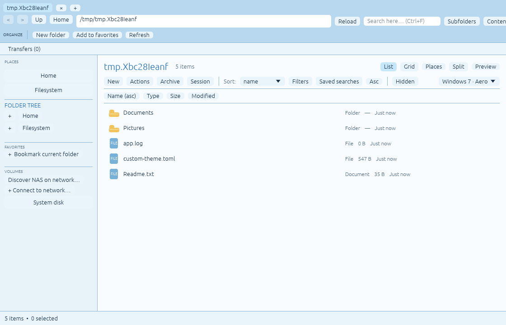
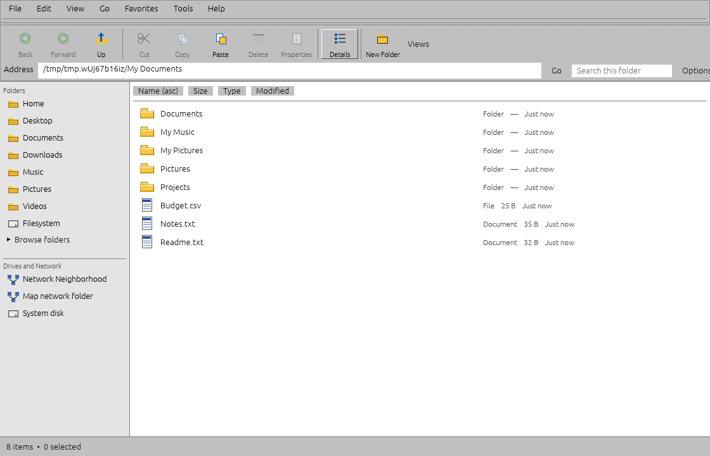
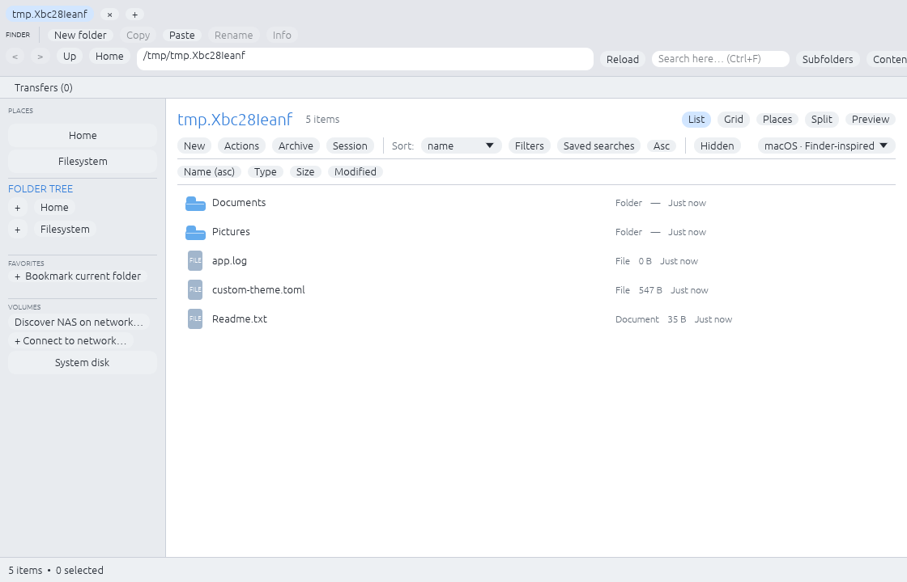
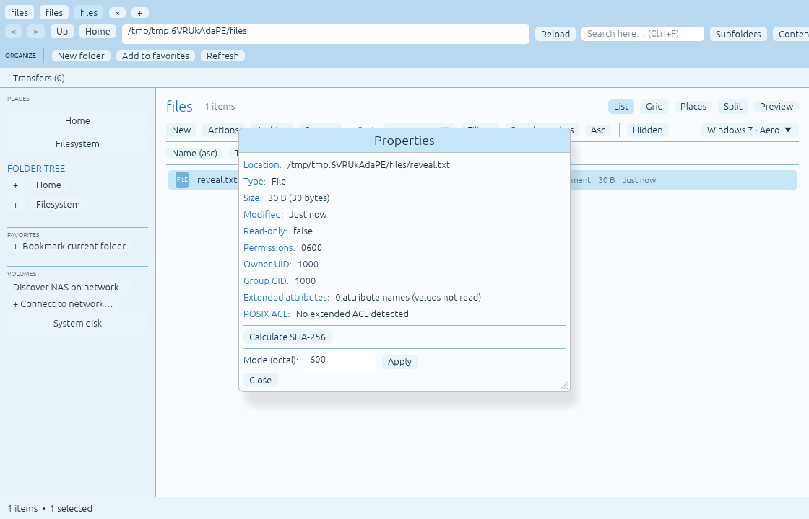
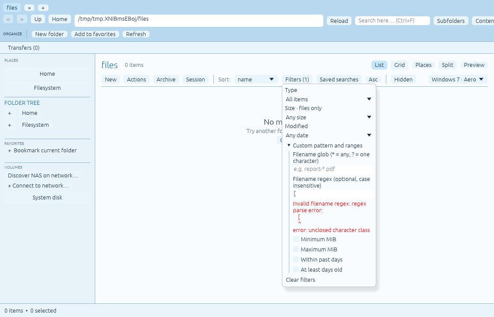

# RiceField 1.0 candidate status

Candidate: **1.0.0-rc.17**, code verification pending. `rc.16` merged as
`5c0f026` after successful [GitHub CI](https://github.com/CopyPasteUser/Ricefield/actions/runs/42171451914),
including guarded USB PowerOff. `rc.15` merged as
`5c701c4` after successful [GitHub CI](https://github.com/CopyPasteUser/Ricefield/actions/runs/42168980032),
including no-overwrite local user attributes. `rc.14` merged as
`23b6cba` after successful [GitHub CI](https://github.com/CopyPasteUser/Ricefield/actions/runs/42168349053),
with descriptor-bound UID/GID editing. `rc.13` merged as
`78ff916` after successful [CI run #534](https://github.com/CopyPasteUser/Ricefield/actions/runs/42167135309):
295 Rust tests, one D-Bus protocol test and eight GUI profile checks passed.
`rc.12` merged as
`21d691d` after successful [CI run #531](https://github.com/CopyPasteUser/Ricefield/actions/runs/42166494815),
adding guarded descriptor-bound POSIX chmod. `rc.11` merged as
`7443c4f` after successful [CI run #528](https://github.com/CopyPasteUser/Ricefield/actions/runs/42165850788),
adding native UDisks2 unmount/eject with fresh-state guards.
`rc.10` merged as
`a5be354` after a successful [CI run #525](https://github.com/CopyPasteUser/Ricefield/actions/runs/42164953147)
(including Rust tests, FileManager1, eight GUI themes, release, install and
rollback). `rc.9` has passed its
GitHub CI checks after [PR #72](https://github.com/CopyPasteUser/Ricefield/pull/72)
and the remote-write safety clarification in
[PR #73](https://github.com/CopyPasteUser/Ricefield/pull/73).
`rc.8` merged as
`d0c57b2`; [CI run #514](https://github.com/CopyPasteUser/Ricefield/actions/runs/42159106896)
passed 282 Rust tests, one separate D-Bus test, eight GUI profiles, release
build, installation and rollback. `rc.7` was merged as
`04e2936`; [CI run #509](https://github.com/CopyPasteUser/Ricefield/actions/runs/42156620306)
passed 275 Rust tests, one separate D-Bus test, eight GUI profiles, release
build, install and rollback. Previous `rc.6`
was merged as `49c1cdd`; [CI run #503](https://github.com/CopyPasteUser/Ricefield/actions/runs/42119605536)
passed 267 Rust tests, one separate D-Bus test and eight GUI profiles. `rc.5`
was merged as `5f9b317`; [CI run #495](https://github.com/CopyPasteUser/Ricefield/actions/runs/42116233847)
passed 263 Rust tests, one separate D-Bus test and eight GUI profiles.
Subsequent safety fix `b61d256` passed 265 Rust tests and eight GUI profiles
([CI run #499](https://github.com/CopyPasteUser/Ricefield/actions/runs/42117763127)).
`rc.4` was merged as `3008225` and `rc.3`
was merged as `332529b`. GitHub Rust checks
[run #481](https://github.com/CopyPasteUser/Ricefield/actions/runs/42107821509)
passed. The previous `rc.2` merge was `29e5cb3` (run #477); the original
`b09a397` baseline had 248 passing tests. Physical acceptance is still open.

This is a reviewable candidate, **not a completed stable 1.0 release**.
The earlier roadmap still contains unimplemented functionality. Nothing in
this document marks that functionality or unavailable hardware tests complete.

## Candidate scope

| Area | Implemented behavior | Boundary |
| --- | --- | --- |
| Local navigation | Tabs/history/session, split panes, tree, list/grid, natural sorting, keyboard and quick actions | Local and system-mounted paths; inaccessible devices surface errors |
| Local writes | No-overwrite copy, same-volume rename/move, trash/delete confirmations, links, descriptor-bound Unix permission and explicitly authorized owner/group edits, plus no-overwrite local `user.*` attributes and cycle-safe batch rename with session-only guarded Undo | Cross-volume Move retains the original; verified replacement, privileged ACL/owner workflows and durable restart-safe batch Undo are not implemented |
| Recovery | Durable move evidence, read-only inspection/comparison, separately confirmed safe copy, bounded cross-restart transfer summaries | No automatic journal replay, source deletion or crash rollback; prior per-item detail and Undo are not persisted |
| Remote | Validated URI tabs, readable network names, bounded read-only listing/search/text preview, explicit connection/discovery, optional Secret Service login, and no-overwrite file/folder downloads to a configurable local folder | No remote writes: [generic GIO rename fails the atomic no-overwrite race gate](REMOTE-WRITE-SAFETY.md). Directory downloads are content-only; real NAS tests outstanding |
| Removable storage | Mounted paths via mountinfo; UDisks2 discovery of removable filesystems, explicit mount, fresh-state-checked unmount, eject and supported USB PowerOff via Polkit, GIO fallback for other mounts | Real USB/Polkit acceptance and encrypted-volume unlocking remain outstanding; PowerOff refuses drives with mounted partitions |
| Archives | Local create/browse/verify/staged extraction with limits and ZIP encryption | Backend-dependent 7z/RAR decryption; broad corpus/device acceptance outstanding |
| Search | Filename/content search, glob, Unicode regex, ranges, opt-in saved searches and duplicate candidates | Bounded scans, no index; incomplete results are labeled |
| Desktop | MIME Open With, URI launch, optional native FileManager1, helper drag-out | No portal integration or direct framework drag-out; no default-manager change |
| Themes | Seven shells and custom composition, visual editor, explicit TOML live reload | No direct RiceBowl event IPC or arbitrary Rust component registry |
| Language/accessibility | Existing English UI, keyboard controls, framework accessibility, narrow-window smoke | German localization and real screen-reader/HiDPI/multi-monitor acceptance remain open |

## Changes in this candidate

- `rc.17` hardens desktop installation: the SVG icon is copied into a private
  same-directory temporary file, then atomically renamed into place. A
  deterministic slow-copy test proves an upgrade does not expose an incomplete
  icon while the new bytes are being written. The tagged release workflow
  also uses bounded, retried graphics dependency installs, consistent with
  normal CI. Special-file safety tests retain socket fixtures when available
  and fall back to FIFOs under sandbox restrictions rather than being skipped.
  These changes do not make the three-path installer power-loss
  transactional or close the remaining network-write/recovery gates.

- `rc.16` exposes a confirmable power-off for USB drives that advertise the
  UDisks2 capability. It refreshes the daemon's raw inventory, verifies no
  sibling block filesystems are mounted (including hidden/ignored ones),
  rejects missing capability or unknown active uses, and invokes UDisks2's
  Drive.PowerOff with normal Polkit authorization. No force/unmount fallback,
  direct privileged command or automatic power cut occurs; physical USB tests
  are still outstanding.

- `rc.15` adds a bounded text editor for creating *new* Linux `user.*`
  extended attributes. The operation opens the selected regular file or
  directory without following symlinks, checks the Properties metadata against
  that file descriptor and uses kernel-atomic `XATTR_CREATE` to refuse any
  pre-existing name even if another process creates it concurrently. It never
  reads or replaces existing values. Unsupported filesystems, permission
  errors and unimplemented privileged/ACL management remain explicitly open.

- `rc.14` adds numeric UID/GID fields in Properties for ordinary, authorized
  Linux ownership edits. O_PATH plus fchownat with AT_EMPTY_PATH targets an
  opened inode, validates against the Properties metadata, refuses symbolic
  links/stale entries and never escalates privileges. The kernel decides which
  changes are permitted; administrator-owned files will normally return a
  permission error. This is not a Polkit-backed privileged owner editor or
  an advanced POSIX ACL rule editor.

- `rc.13` additionally binds the permission editor to the exact inode and
  filesystem metadata obtained when the Properties dialog was read. The
  worker revalidates that snapshot on its already opened, no-follow FD before
  chmod, and refuses a modified/replaced file instead of applying permissions
  to a newly occupied pathname. A deterministic replacement regression covers
  the stale-dialog case. This is not general ACL/ownership editing.

- `rc.12` closes a real check/act race in basic Unix permission changes. The
  former code checked a pathname with `symlink_metadata` but then ran a
  path-based chmod that could follow a replacement symlink. Operations now
  open the selected inode without following symlinks and apply permissions
  on the pinned descriptor. Linux O_PATH/fchmodat2 allows changes to owned
  files without read permission on modern kernels; on older kernels it fails
  safely rather than reintroducing the race. Disposable regression tests
  replace the selected name after open and verify the unrelated target is
  untouched. Full ACL and ownership editing remain out of scope.

- `rc.11` correlates mounted removable filesystems with mountinfo and prefers
  native UDisks2 unmount/eject for recognized devices. A fresh UDisks2 state
  check guards against stale mountpoint selection; non-removable and unknown
  mounts keep the existing GIO path. Eject requires the drive to advertise
  that capability, and forced unmount/power-off are not performed. Additional
  unit tests cover raw Unix mountpoint decoding, malformed input and invalid
  D-Bus object paths. Real USB hardware testing is still outstanding.

- `rc.10` detects eligible unmounted removable/USB partitions using the system
  UDisks2 ObjectManager with a throttled, non-UI-thread lookup. A user can
  explicitly mount such a partition via UDisks2 and the desktop's Polkit agent;
  there is no privileged helper or command-line path injection. Missing UDisks2
  is nonfatal. Fake inventory tests cover ignored, already-mounted, malformed
  and non-removable objects, but the real USB/Polkit path is **not** accepted.

- `rc.9` offers session-only Undo for fully successful batch rename operations,
  including swaps and cycles. Before any reversal, verify *all* post-rename
  entries against saved metadata and ensure original target names are still
  available or part of the same batch. A collision or changed file refuses
  the Undo before mutation; ordinary step errors trigger guarded rollback.
  No replay or Undo is available after restart, and partial failed batches
  cannot be undone automatically.

- `rc.8` supports selected-name swaps and cycles in batch renames using Linux
  atomic exchanges, with no-overwrite moves for free target names. Preflight
  rejects collisions with unselected entries. Ordinary failures try a guarded
  reverse traversal; external changes stop rollback and surface partial
  locations for manual review. A process crash can leave partially permuted
  names; no automatic recovery or durable batch Undo is claimed.

- `rc.7` persists the latest 64 local transfer result summaries (outcome,
  duration and item counts) in private, versioned state. A bounded, serialized
  background worker and interprocess lock prevent UI blocking and competing
  writers. Corrupt files remain untouched; restart never replays mutations or
  restores unsafe Undo actions. Detailed per-item evidence remains in-session;
  this feature is informational history, not full transfer recovery.

- `rc.6` adds a bounded FIFO of 16 pending remote file/folder downloads.
  Every target directory is snapshotted at selection time; only one download
  runs at once, with cancellation of the active operation and removal of
  waiting entries. Pause after the current job, resume manually and pause
  automatically on error. Waiting transfers are intentionally not persisted
  for automatic replay after an interrupted process. Real NAS/slow-network
  behavior remains a physical acceptance gate.

- `rc.5` adds opt-in regular-expression search/replacement to batch rename
  previews, with capture groups, bounded compilation and UTF-8-only search,
  while preserving byte-exact prefix/suffix/numbering and no-overwrite renames.
  Regex rename does not implement safe cycles, batch rollback or undo.
  Follow-up hardening distinguishes regular remote files from GIO symlink/
  special entries and refuses to download/preview or recursively traverse
  those entries. Full NAS and symlink acceptance remains a physical test gate.

- `rc.4` adds bounded recursive downloads of remote folders. GIO listing and
  reads stay read-only; descendants are staged privately and published as a
  directory only after all files and directories sync successfully. Traversal,
  count (4,096 entries/512 directories), depth (16), cumulative bytes (8 GiB),
  timeout (20 minutes), cancellation and no-overwrite limits fail closed.
  Remote ACLs, timestamps and ownership are not preserved. Live NAS and
  disconnect acceptance are outstanding.

- `rc.3` decodes valid percent-escaped remote filenames for display without
  ever changing the canonical action URI; malformed/control-bearing labels
  remain escaped. An absolute path field selects and remembers the local
  download folder, rejecting relative paths and `..` traversal. The displayed
  app/launcher/CLI branding is now RiceField while the existing `rice-explorer`
  binary name and on-disk settings remain compatible.

- `rc.2` adds an explicit one-file-at-a-time NAS download to `~/Downloads`
  through `gio cat`, on a worker thread. A private local staging directory,
  8 GiB/20-minute limits, cancellation and a Linux atomic no-overwrite rename
  avoid exposing partial files as completed downloads. Failures preserve
  existing targets. Offline, authentication, interrupted USB/NAS and a real
  streaming performance acceptance are pending; do not treat this as native
  remote write support.

- Shortcut dispatch reads each key event's modifiers, preserving complete
  Ctrl/Alt chords that arrive between frames. An event that opens a dialog
  stops subsequent global shortcuts in that frame.
- CLI/address file-to-parent resolution, symlink-folder classification and
  sidebar place availability move to background filesystem snapshots.
  A file argument reveals its containing folder without opening the file.
- `--file-manager-service` provides `org.freedesktop.FileManager1` at
  `/org/freedesktop/FileManager1`. Folder requests accept supported local and
  read-only remote URIs; selection/properties accept local file URIs only.
  Calls contain at most 32 URIs, each at most 4 KiB; the pending queue holds
  16 requests. Existing bus ownership is respected with `DoNotQueue` and no
  replacement. No activation service or system default is installed.
  Requests wait behind confirmation/login/recovery windows. Properties are
  reviewed sequentially; selections remain subject to active visibility filters.
- Optional case-insensitive filename regex combines with existing local
  filters. Unicode matching uses a linear-time engine with a 512-byte pattern
  cap and 1 MiB compilation/cache caps. Invalid patterns show an inline error
  and no matches. Glob remains the default, and old settings stay readable.
  Editable menus close only on outside clicks or Escape, so expanding options
  and editing a pattern no longer dismisses the Filters popup.
- `--benchmark` creates an exclusively owned private directory under `TMPDIR`,
  creates 100,000 files, measures real scans, sorting, glob and bounded search,
  then performs a staged 64 MiB Copy and checks every byte and source retention.
  The directory is removed on ordinary success/failure. A killed process can
  leave a `rice-explorer-bench-*` directory; it contains only generated fixtures.
- `scripts/measure-desktop.sh` reports Xvfb mapped-window latency (not complete
  interactive readiness), idle RSS, and ten-second CPU usage for one process.
  Software GL and the cloud filesystem are explicitly lab conditions.
- CI and release workflows run private-bus and visible desktop integration
  checks and retain performance reports. Bundles carry this status document.

## Repeatable automated checks

```bash
cargo fmt --all -- --check
cargo clippy --locked --all-targets -- -D warnings
cargo test --locked --all-targets
dbus-run-session -- env RICE_EXPLORER_TEST_BUS=1 cargo test --locked \
  desktop::tests::private_bus_roundtrip_and_existing_owner_are_respected -- --ignored --exact
bash scripts/test_desktop_entry.sh
bash scripts/test_install_transaction.sh
cargo build --locked --release
target/release/rice-explorer --benchmark > performance-filesystem.toml
timeout -k 10s 8m xvfb-run -a -s '-screen 0 1280x800x24' bash scripts/gui_smoke.sh
timeout -k 5s 60s dbus-run-session -- env RICE_EXPLORER_TEST_BUS=1 \
  xvfb-run -a bash scripts/test_file_manager_service.sh
timeout -k 5s 60s xvfb-run -a bash scripts/measure-desktop.sh
timeout -k 5s 60s xvfb-run -a bash scripts/test_filters.sh
SOURCE_DATE_EPOCH=$(git show -s --format=%ct HEAD) bash scripts/package-release.sh
(cd dist && sha256sum --check -- *.sha256)
```

Dependencies: Rust stable, Linux graphics libraries, runtime libarchive,
D-Bus/GIO, Xvfb/xauth/xdotool, ImageMagick and GNU coreutils. The private-bus
unit test is intentionally ignored in the ordinary suite so that tests never
claim a name on a developer's real desktop bus. The explicit command runs it.
FIFO/permission/ACL tests need a filesystem and sandbox allowing those fixtures.

## Verified lab evidence (2026-11-05)

Debian 13 x86_64 cloud executor, Rust 1.99.1, runtime libarchive 3.7.4.
These are single-run observations, not hardware guarantees or pass thresholds.

| Check | Observed result |
| --- | --- |
| Format / Clippy | Pass; warnings denied |
| Unit/regression suite | rc.3 GitHub CI run #481: 258 passed, 0 failed, 1 isolated private-bus test intentionally ignored in ordinary suite |
| Private D-Bus protocol / existing owner | 1 additional test passed in run #481 |
| Installer / upgrade / injected rollback / overlapping uninstall | Passed in isolated homes |
| Native GUI | All seven themes plus custom composition passed split/dialog/tab/compact/narrow and distinctness smoke in run #481 |
| FileManager1 GUI | Local reveal visibly selected; properties visibly opened; unsafe URI rejected |
| Editable Filters GUI | Invalid regex corrected through mouse/keyboard; saved value verified and one matching file displayed |
| Release packaging | Two independently staged archives compared byte-for-byte; SHA-256 manifest verified |
| 100k real files | Scan 197.279 ms; natural sort 44.922 ms; glob 11.704 ms |
| Bounded filename search | 173.473 ms; 11 matches; reported complete on this fixture |
| Staged 64 MiB copy | 47.540 ms; every byte verified; original retained |
| Xvfb window mapped | 245.809 ms (not complete interactive readiness) |
| Idle sample | 10.005 s; 95,640 KiB RSS; 0.800% of one CPU core |

Representative actual lab captures:







The `--benchmark` output and desktop measurement files are also kept as
workflow artifacts on new CI runs. The original upstream green CI does not
prove this candidate's new code; inspect the candidate branch's own checks.

## Post-code-freeze device acceptance

Run with disposable data and retain the precise candidate binary/checksum,
Mint version, filesystem, session type and results. These are the remaining
device gates, not a request to approve an alpha in the middle of development.

| Test | Procedure and pass condition |
| --- | --- |
| Mint X11 and Wayland | Launch from app menu; use keyboard/pointer, tabs/split, search and dialogs in every shell; no clipped actions or crashes |
| 4 GB system | Measure real startup, idle CPU/RSS and sustained browsing; record memory pressure and frame responsiveness |
| HDD and 100k items | Set `TMPDIR` to a disposable HDD lab directory and run benchmark; also navigate/scroll/filter the large folder interactively |
| Copies/conflicts | Copy files/folders with symlinks, hardlinks, ACL/xattrs; compare contents and metadata; competing names never overwrite |
| Permissions | Edit a disposable file/directory mode, an unreadable owned file, a symlink and a concurrently replaced name; never chmod the symlink target |
| Owner/group | On disposable owned files, test no-op/current UID/GID, authorized supplementary group changes, denied UID changes, stale selection and symlinks; verify no unexpected ownership change |
| Extended attributes | On disposable ext4 and removable volumes, create a new `user.*` text attribute, verify its value, retry the same name (must fail without replacement), then try a stale file selection and a filesystem without xattrs |
| Cross-volume Move | Verify the new copy and the retained original; do not mistake retention for successful automatic source removal |
| USB interruption | Unplug during a disposable transfer; errors/per-item outcomes must be clear, originals remain recoverable, no incomplete target appears complete |
| USB mount/unmount/eject/power-off | With a disposable USB volume, verify its appearance before mounting, Polkit authorization, navigation after mount, busy-filesystem refusal, explicit unmount/eject and unplug/replug state updates; where UDisks2 advertises PowerOff, verify explicit confirmation and that a still-mounted sibling partition blocks it before safe removal |
| Restart/recovery | Interrupt a disposable transfer; restart and inspect evidence; do not delete either side based on journal metadata alone |
| NAS/offline/auth | Discover/connect Synology; test wrong credentials, locked/unlocked Secret Service, disconnect/reconnect and read-only errors without freezing |
| Remote download | Download a disposable small/binary/large file to Downloads; test collisions, encoded filenames, cancellation and network loss; verify source hash separately and ensure no incomplete target becomes a final file |
| Remote folder | Download nested disposable folders including hidden files and UTF-8 names; test abrupt network loss, cancellation, folder collisions, symlinks and limits; verify full tree and source independently |
| Archives | Create/verify/extract all advertised formats; test wrong password, cancel, existing destination and supplied external compatibility fixtures |
| Desktop interoperability | With no other owner, run opt-in FileManager1 and invoke browser “Show in folder”; verify existing Thunar ownership is never displaced |
| Installation lifecycle | Clean install, upgrade, uninstall and ordinary injected rollback; settings survive uninstall; menu points at the installed binary |
| Power loss | Separate physical/VM fault lab; installer multi-path updates and filesystem durability are not proven by ordinary rollback tests |
| Accessibility | Screen reader, keyboard focus, high contrast, HiDPI and two monitors on both desktop session types |

## Stable release decision

Stable `v1.0.0` is not created automatically by these changes. Review the open
code capabilities above against the desired 1.0 scope, finish the relevant
implementation and automated checks, then review device results and fix
critical findings before tagging. Green CI and a candidate package number
alone do not meet that gate. Keep Thunar available until it is met.
