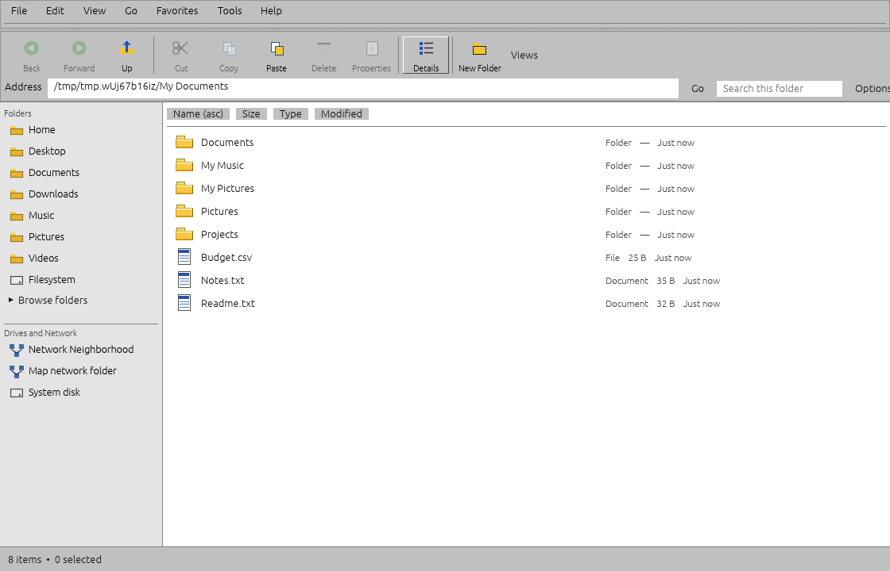
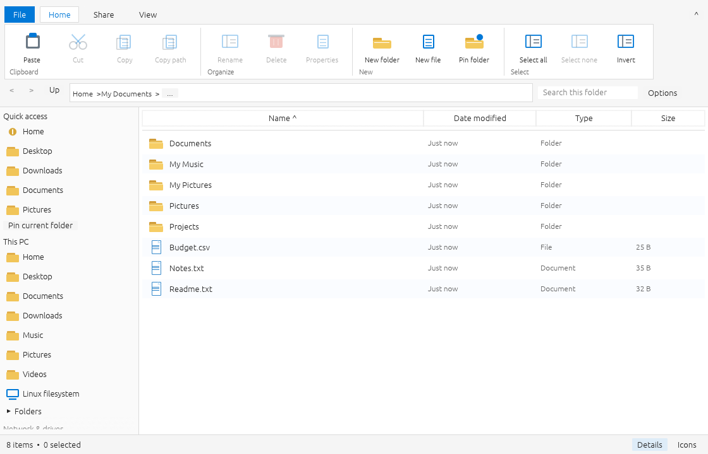
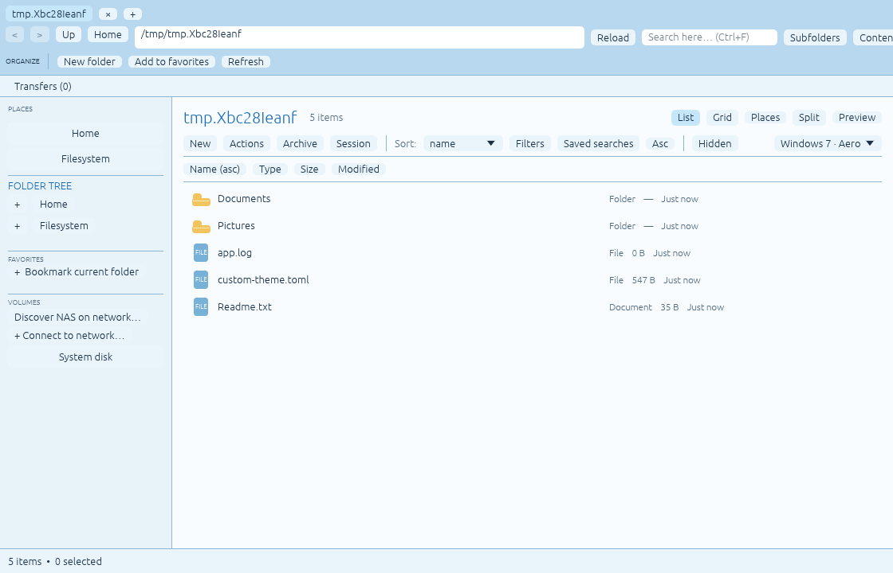
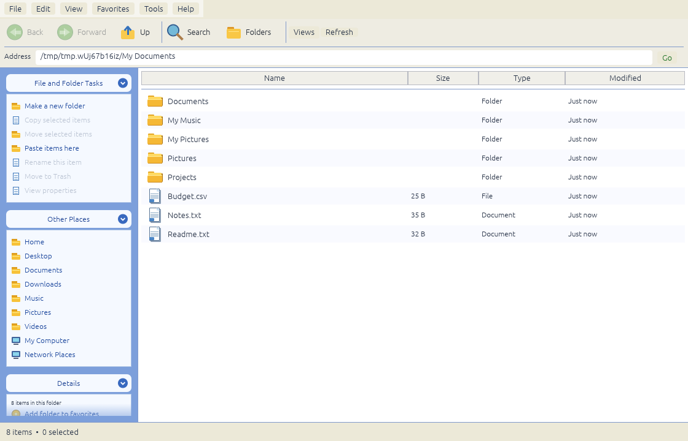
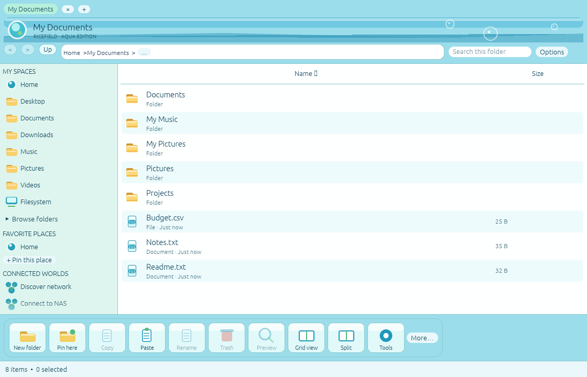
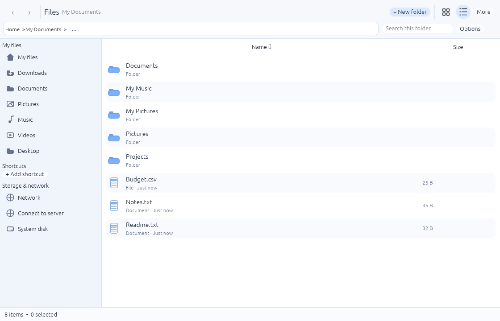
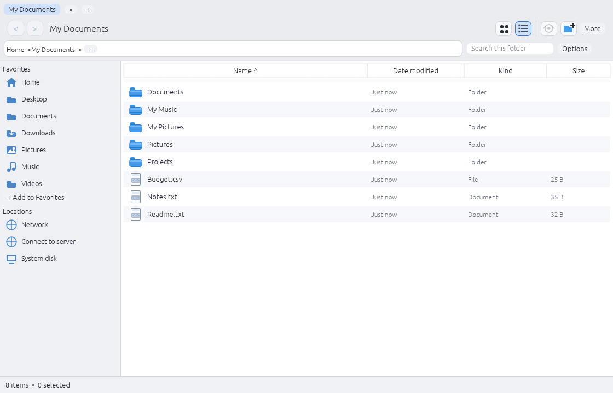

# RiceField screenshots

These are unedited screenshots captured from the **running Rust/egui application** in GitHub Actions' Xvfb GUI smoke test. The fixtures contain disposable example files; the images are not renders or concept mockups. They verify rendering, not usability on a physical Linux desktop. The seven main views below include the post-network-list and distinct-file-row styling from the successful [GUI smoke run #42360627410](https://github.com/CopyPasteUser/Ricefield/actions/runs/42360627410); supplemental views were captured earlier and are kept for coverage until refreshed.

## Windows 98 · Classic Explorer

| Additional view | Screenshot |
| --- | --- |
| Functional Tools menu | [win98-tools.png](win98-tools.png) |
| Two-folder split | [win98-split.png](win98-split.png) |
| Compact window (700 × 470) | [win98-compact.png](win98-compact.png) |
| Narrow window (380 × 650) | [win98-narrow.png](win98-narrow.png) |

The gray menus, period-style bevel controls, Address/Go line and Folders/Drives
rail are deliberately unlike the blue XP task pane or the modern File shells.
File/volume actions remain real, with guarded mutations and native WM captions.

## Windows 10 · Explorer ribbon

| Additional view | Screenshot |
| --- | --- |
| Two-folder split (1120 × 720) | [win10-split.png](win10-split.png) |
| Compact window (700 × 470) | [win10-compact.png](win10-compact.png) |
| Narrow window (380 × 650) | [win10-narrow.png](win10-narrow.png) |
| View ribbon page | [win10-view.png](win10-view.png) |
| Share ribbon page | [win10-share.png](win10-share.png) |

The ribbon has File/Home/Share/View pages with enabled-state-aware commands;
compact and narrow windows wrap to a smaller command set with a More menu.

## Windows 7 · Aero rice

| Additional view | Screenshot |
| --- | --- |
| Two-folder split (1120 × 720) | [win7-split.png](win7-split.png) |
| Compact window (700 × 470) | [win7-compact.png](win7-compact.png) |
| Narrow window (380 × 650) | [win7-narrow.png](win7-narrow.png) |

## XP Luna rice

| Additional view | Screenshot |
| --- | --- |
| Two-folder split | [xp-luna-split.png](xp-luna-split.png) |
| Compact window (700 × 470) | [xp-luna-compact.png](xp-luna-compact.png) |
| Narrow window (380 × 650) | [xp-luna-narrow.png](xp-luna-narrow.png) |
| New-folder dialog | [xp-luna-dialog.png](xp-luna-dialog.png) |

## Frutiger Aero · Blue Skies rice

| Additional view | Screenshot |
| --- | --- |
| Interactive Tools dock (1120 × 720) | [frutiger-aero-tools.png](frutiger-aero-tools.png) |
| Two-folder split (1120 × 720) | [frutiger-aero-split.png](frutiger-aero-split.png) |
| Compact window (700 × 470) | [frutiger-aero-compact.png](frutiger-aero-compact.png) |
| Narrow window (380 × 650) | [frutiger-aero-narrow.png](frutiger-aero-narrow.png) |

Original vector icons, a sky-and-water masthead and a responsive bottom dock;
no downloaded or proprietary operating-system assets. File actions remain
shared. Network tabs support browsing and downloads, plus a separately gated
WebDAV-only single-file upload; other protocols are intentionally read-only
until their collision-safe writes are verified.

## ChromeOS · Files rice

| Additional view | Screenshot |
| --- | --- |
| Clicked icon-grid view | [chromeos-icons.png](chromeos-icons.png) |
| Open functional More menu | [chromeos-more.png](chromeos-more.png) |
| Split view | [chromeos-split.png](chromeos-split.png) |
| Compact window (700 × 470) | [chromeos-compact.png](chromeos-compact.png) |
| Narrow window (380 × 650) | [chromeos-narrow.png](chromeos-narrow.png) |

Unlike Finder or Explorer, the Files shell groups My files, shortcuts and
storage/network locations beneath a compact material-style toolbar. It uses
original flat blue folder/file vectors and no Google services or assets.
The overflow menu, grid/list toggle and navigational controls are live.

## macOS · Finder rice

| Additional view | Screenshot |
| --- | --- |
| Clicked icon-view mode (1120 × 720) | [macos-icons.png](macos-icons.png) |
| Open functional More menu (1120 × 720) | [macos-more.png](macos-more.png) |
| Two-folder split (1120 × 720) | [macos-split.png](macos-split.png) |
| Compact window (700 × 470) | [macos-compact.png](macos-compact.png) |
| Narrow window (380 × 650) | [macos-narrow.png](macos-narrow.png) |

Original blue-folder/file vectors and Finder-like navigation, Favorites and
Locations, with functional icon/list switches, Quick Look and More commands.
There are no Apple icons or imitation traffic-light window controls: native
decorations come from the desktop/window manager.

Theme-specific UI uses original RiceField vector shapes and styling; no Microsoft assets or branding are copied. OS-level window decorations are left to the window manager / RiceBowl.
